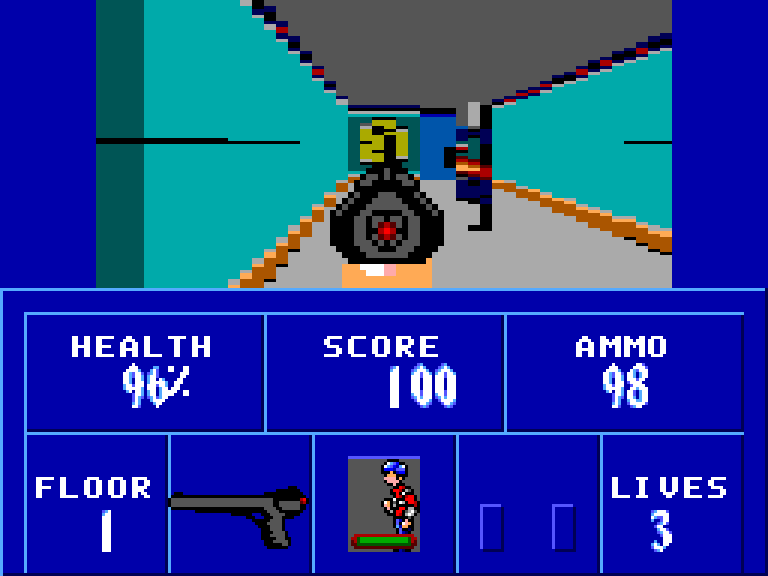
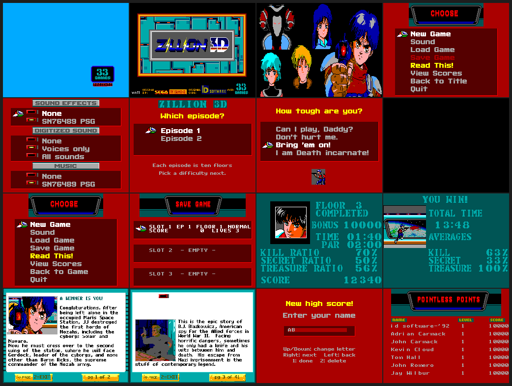

# Zillion 3D for the Sega Master System

A port of **Zillion 3D** — [moonkey's Wolfenstein 3D mod](https://moonkey.itch.io/zillion-3d) — to the Sega Master
System: **both episodes, all twenty floors**, with every texture, sprite, wall, screen, sound effect, song and
digitised voice converted from the mod's own Wolfenstein 3D (`.WL6`) data.  A textured 192 x 96 view, the whole
front end, high scores, three save slots, and the sound and music of the original.

| | |
|---|---|
| the mod | [moonkey.itch.io/zillion-3d](https://moonkey.itch.io/zillion-3d) — a Wolfenstein 3D *registered* (WL6) mod, two episodes |
| the game logic and the assets | [haroldo-ok/zillion-3d-md](https://github.com/haroldo-ok/zillion-3d-md) — the same game ported to the Mega Drive / SGDK (both episodes already converted there): the reference for behaviour |
| the engine this port starts from | [haroldo-ok/wolf-3d-sms](https://github.com/haroldo-ok/wolf-3d-sms) — the SMS Wolfenstein 3D port: ray caster, front end, saves, sound, tests, banks |

## What is in it

| area | state |
|---|---|
| 3-D view: textured walls, doors, sprites | done: **192 x 96** (24 x 12 tiles, 48 rays of 4 px), Wolfenstein's own 72 degree projection |
| **both episodes, all 20 floors** (10 per episode, floor 10 is the secret floor) | done, each level tested in the emulator |
| enemies, AI, weapons, pickups, HUD, weapon in hand | done |
| per-level ceiling colour, par time and song (the mod's `vgaCeiling`, `parTimes`, `songs`) | done, for both episodes |
| title (PG-13, title, credits, scores: the attract loop), main menu, new game (episode, then one of BJ's four difficulties), sound menu, quit | done: every screen is the mod's own art, tile converted |
| Get Psyched, level completed (par time, kill / secret / treasure ratios and bonuses), secret floor, victory (per-episode), end text | done, with the rules of `WL_INTER.C` |
| help ("Read This!", 41 pages) and the end texts | done: the original page layout engine (`WL_TEXT.C`) run offline, the keyboard pages rewritten for the SMS pad |
| high scores (7, name entry with the D-pad) | done, kept in cart RAM |
| 3 save slots | done: cart RAM page 1, mid-level, exact (see below) |
| 87 sound effects, 16 digitised voices, 27 songs | done: SN76489 player in the frame interrupt, voices by the line interrupt |
| demo playback | not included (the Genesis port omits it too) |

The 20 floors come from the mod's `GAMEMAPS.WL6` (the maps named `Zillion3D_E1_L1` … `Zillion3D_E2_L10`); the 61
screens, the 87 effects, the 27 IMF songs and the 16 sampled voices come from `VGAGRAPH/VGAHEAD/VGADICT.WL6`,
`AUDIOT/AUDIOHED.WL6` and `VSWAP.WL6` of the same download.  Nothing is a placeholder.

The ROM is **4,030,464 bytes** (246 banks of 16 KB in a standard Sega mapper; 32 KB cart RAM: page 0 the level,
page 1 the saves and scores).  It needs sprite magnification (the weapon) and battery RAM (saves, scores).

## Building

You need Linux x86-64 (the only host tried), python3 with numpy and Pillow, curl, unzip, git and a C compiler.

    tools/setup_toolchain.sh    # once: SDCC 4.4.0 -> ~/sdcc440, makesms + peephole rules -> ~/.devkitsms
    tools/fetch_data.sh         # once: id's source release (palette, names); tells you where to put the mod's data
    make                        # wolf3d.sms

The game data itself is the **Zillion 3D** download from itch.io (a Windows `.zip` of `*.WL6` files — `VSWAP`,
`VGAGRAPH`, `VGAHEAD`, `VGADICT`, `GAMEMAPS`, `MAPHEAD`, `AUDIOT`, `AUDIOHED`, `CONFIG`).  itch.io needs a session to
hand out the file, so `tools/fetch_data.sh` does not download it: put the zip in `../work/data/zillion3d.zip` (or
unzip it there) and the script unpacks and checks it.  The converters read `*.WL6` (a registered game's data: this
mod is not shareware), from `../work/data` unless `WL_DATA` says otherwise.

The first `make` converts all of the mod's data into `gen/` in one go (a grouped make target): about 50 seconds (textures, sprites, the renderer's
scalers and tables, the 20 maps, the HUD and weapon art, the 61 screens, the audio) and writes 230 data banks.
The results are cached in `gen/cache/`, so a rebuild after changing a converter takes about 30.  Then:

    make DEBUG=1    # wolf3d_dbg.sms: boots into the game, the test hooks (dbg_*); objects in build_dbg/
    make DET=1      # wolf3d_det.sms: the deterministic build of the equivalence tests; build_det/
    make NOGEN=1    # do not run the converters: use the gen/ that is there (it must have been made before)
    make clean      # the objects and the ROM of the chosen flavour; gen/ stays

The scripts and the Makefile look in these places, and each can be moved:

| what | default | override |
|---|---|---|
| SDCC 4.4.0 | `~/sdcc440/sdcc-4.4.0/bin` | `make SDCCBIN=...` |
| `makesms`, `peep-rules.txt` (devkitSMS) | `~/.devkitsms` | `make DK=...` |
| the mod's `*.WL6` data | `../work/data` (or `work/data`) | `WL_DATA=...` |
| id's source release (names, palette) | `../work/wolf3d` (or `work/wolf3d`) | `WL_SRC=...` |
| the Genesis port (only `tools/port_game.py`) | `../wolf-3d-md/src` | `WL_MD=...` |

**SDCC must be 4.4.0.**  4.5.0 miscompiles `if (a != g) { g = a; ... }`, and 4.4.0 needs `--reserve-regs-iy` (see
*Toolchain pitfalls*).  Do not use a distribution's `sdcc`.

## Controls

D-pad: up/down walk, left/right turn.  Button 1: fire.  Button 2: use (doors, the elevator); held with left/right
it strafes; pressed while holding down it changes weapon.  The console's **Pause** button opens the menu during the
game.  In menus: up/down moves the gun, button 1 selects, button 2 (or Pause) backs out.  Name entry: up/down change
the letter, right/left move, button 2 deletes, button 1 (or Pause) is done.

A game frame takes 0.1 - 0.2 s, so the pad is sampled at every vblank and the game gets what happened since its
last poll: a button press is a fresh press even when it was over before the poll (taps on a touch overlay work),
and a direction moves the player for as long as it was held within the frame.

## How it works

The engine is the one of `wolf-3d-sms`; what follows is what it does, with the numbers of *this* game.

### The front end

* **Screens** (`tools/wl_pics.py`): each is a 256 x 192 picture made of the mod's own pictures and fonts (menus
  composed at the original layout with a 16 pixel item pitch; the 320 x 200 pictures and the help pages scaled by
  dropping the cheapest column of five and row of 25, which never blends colours), turned into 8 x 8 tiles and two
  16 colour palettes (`scrcore.py`: exact SMS gamut, a palette chosen for every cell, similar tiles merged with the
  text protected).  A menu screen has at most 432 tiles (its cursor's 12 sprite tiles take 436 - 447), a picture
  screen 440 - 448.  A menu highlights an item by switching the palette bit of its cells (palette 1 = palette 0 but
  for the ink slots); the cursor is six hardware sprites; numbers on the intermission are 16 x 16 digit glyphs
  written into the name table; names and scores use an 8 x 8 font cut from the original small font.  Layout
  constants (`LAY_*`) are generated into `gen/assets.h`.  61 screens, 661,754 bytes.
* **Flow** (`src/main.c`, `inter.c`, `menu.c`): PG-13, then title / credits / scores until a button; the control
  panel; `GameLoop` (the original's) with Get Psyched, level completed, died, victory, end text, high scores.  New
  Game asks the **episode** first, then the difficulty (as the Genesis port does).
* **Help and end texts** (`tools/wl_text.py`): the page layout of `WL_TEXT.C` (fonts, pictures, line breaking, the
  `^` commands) is run at build time, so the ROM holds finished pages (41 help pages, 2 end screens).
* **Per-episode rules**: the elevator and the secret floor are floor 10 *of the episode*; the victory screen
  averages the episode's par times; the floor number on the HUD is 1 - 10 within the episode.

### Saves and scores (`src/save.c`)

* 3 slots of 5.25 KB (`SLOT_SIZE` 0x1500).  The level is *rebuilt* on load (`SetupGameLevel`), then only what the
  player changed is applied: the game state, the area overrides, the doors, the statics and the actors (zero run
  length coded, checksummed).  The largest save seen over the ten floors of episode 1 is 4,592 bytes.
* `tests/t_save.txt` hashes the whole game state (actors, statics, doors, tile and actor maps) before a save,
  damages it, loads, and requires the same hash: on ten floors of both episodes and with a moving door.
* **Scores** live in cart RAM page 1 with a checksum (7 entries).  `tests/t_scores.py` enters a name, quits from the
  menu (the program starts again: the player is back on the start tile) and requires the same table afterwards.
* After a load the code that keeps caches must reset them (`save.c` does): `STATICS_CHANGED()` (def.h:
  `CheckPickups`, the statics list of the renderer, the exit tile test), `doors_busy` (the number of doors that are
  not closed, recomputed from `doorobjlist`), `AreaCacheReset()`, and `render_invalidate()` after anything that
  overwrote the view's tiles.

### Sound (`src/snd.c`, `snd_ctl.c`, `tools/wl_audio.py`)

* **Effects**: the mod's AdLib sounds (AUDIOT) -> PSG event streams: pitch = F-number x block x the carrier's
  multiplier, volume from the carrier's ADSR and level, and the ones with jumpy frequency data (gunshots, hits,
  damage) go to the noise channel.  An effect takes tone channel 2 and the noise channel from the music while it
  lasts: 11 KB for all 87.
* **Music**: the 27 IMF songs are simulated (OPL2 register state, 9 channels with envelopes) every 1/70 s and the 3
  most important notes at any moment are given to the 3 PSG voices (no voice flicker, steal only when clearly
  better); 195 KB for all songs.  Streams are read from the frame interrupt (70 ticks a second from the 60 Hz
  clock); the interrupt maps the stream's bank and gives slot 2 back **as it found it**.
* **Digitised voices**: the 16 VSWAP samples -> 7.86 kHz, two PSG channels summed (the volume commands of channels
  1 and 2 are the sample, error diffusion): 323,520 bytes in 20 banks.  The line interrupt (every second line, 96 a
  frame during the picture) writes them from a RAM buffer that the frame interrupt fills, so it never touches the
  mapper.
* Sound menu: sound effects off / on; digitised sound **None / Voices only (default) / All sounds**; music off / on.
* `tools/psg2wav.py` renders an smstest `psglog` to a WAV.

## Tests

    tests/run_all.sh        # builds the three ROMs and runs everything below (about a minute)

`tools/smstest` is a headless Z80 + VDP emulator (with sprite magnification, `waitchange` and `SMSTEST_FLATPAL`
added); `run_all.sh` builds it if it is missing.  `bash tools/st.sh wolf3d_dbg.sms script.txt` runs one script.

* `tests/t_*.txt`, smstest scripts that assert on game state or the screen: boot, walking through the corridor's
  door, a fight (warp + fire: the guard dies, points are added), pickups (ammo, weapon), the damage flash, firing,
  short taps and rapid fire, death and respawn, **all twenty floors loading**, `t_front` (every screen of the
  release ROM is up when it should be, the in-game menu and back), `t_release` (the release ROM), `t_save` (DET).
* `tests/t_audio.py`: the PSG writes of the title music, a digitised voice (by the line interrupt) and an effect.
  `tests/t_scores.py`: a high score survives a reset.
* `tests/check_view.py` compares the ROM's wall geometry with `tools/refview.py`, a float ray caster of the real
  textures and the real map.  **Known open problem:** it fails when the camera is close to a wall (see *Known
  problems*).
* `tests/det/det.py`, **the equivalence test of the optimised code**: eight scripted scenarios (idle, walking
  through doors, turning, a fight, being shot, a room full of sprites, a pickup, **all twenty levels**) run on the
  deterministic build (`make DET=1`: a fixed 24 tic step per frame, a constant random seed, the pad as it is at the
  poll, `dbg_hash` = a hash of the whole game state).  For every frame it compares the hash of the screen (smstest
  `hooklog` at the entry of `ThreeDRefresh`, with `SMSTEST_FLATPAL=1`) and, at the checkpoints, `dbg_hash`, with
  `tests/det/golden.json`.  The golden file was recorded from the code *before* each optimisation (the C
  originals).  `python3 tests/det/det.py --update NAME` re-records scenarios; `--rom/--noi` run another build.
* `src/dbg.c` and `src/dbg2.c` (DET build only; `dbg2.c` is in bank 9) compare each hand written routine with the C
  code it replaced, over many inputs: `act_dec`, `mul_tics`, `LineStep`, the projection (`xf_tile`, `xf_obj`),
  `add_sprite` (random sequences, also past the full list), `in_view`, the sound player (`snd_step` on every song
  and effect stream; `snd_mix` on random mixer states), `rd_buckets`, the 16 x 16 multiply, `TryMove` and
  `tpath_fast` against `T_Path`.  `run_all.sh` asserts that all of the counters are zero, and `dbg_stage` (which
  sub-check is running) shows where a stuck boot is.  The suite is *sampled* now: with this game's 27 songs and 48
  effects per boot the exhaustive version needed minutes of emulator time before the game started.
* Benchmarks: `python3 tools/bench.py walk turn room` (scripts in `tests/bench/`, on `wolf3d_dbg.sms` in real
  time), `tools/prof_wolf.py` (call-graph profile: self and inclusive cycles per function, bank aware; `--callers
  F`, `--tree F`, `--asm F`).  `python3 tools/docshots.py` makes the pictures in `docs/`.

### Test hooks (DEBUG and DET builds)

| symbol | what |
|---|---|
| `dbg_god` | `1`: the player takes no damage |
| `dbg_wx`, `dbg_wy`, `dbg_wdir` | the tile, tile and direction (0 - 3) for `dbg_warp` |
| `dbg_warp` | `1`: teleport the player there (on the next frame) |
| `dbg_map` | `1..20`: restart the game on that floor (1 - 10 episode 1, 11 - 20 episode 2) |
| `dbg_tx`, `dbg_ty` | the player's tile |
| `dbg_hp`, `dbg_ammo`, `dbg_kills`, `dbg_score`, `dbg_lives`, `dbg_ps` | the game state, as the HUD shows it |
| `dbg_ep`, `dbg_floor` | the episode and the floor within it |
| `dbg_svreq`, `dbg_sv_w`, `dbg_sv_r`, `dbg_sv_ok`, `save_len` | save, and what came back (DET) |
| `dbg_hash` | a hash of the whole game state (DET) |
| `dbg_stage` | which self check is running (0 idle, 1 - 5 done, +10 while running) |

## Technical notes

### The view and the memory map

* **View**: 192 x 96 = 24 x 12 tiles at column 4, 48 rays of 4 px; `KH` = 132, wall height `158.4 / distance`
  (`PIXEL_ASPECT` 1.2) from `tools/render_gen.py` through `gen/assets.h` and `gen/assets.inc`.
* **Weapon**: 8x8 sprites with the VDP's magnify bit (R1 bit 0), 8 columns x 6 rows, only the non-empty blocks.
* **Palette**: 16 colours shared by walls and sprites, chosen over *this* game's wall textures and sprites; the
  ceiling colour is the level's own (`vgaCeiling`: episode 1 = 0x1D x 9 + 0xBF, episode 2 = 4E 4E 4E 1D 8D 4E 1D
  2D 1D 8D).  The damage flash is capped at level 2 of 3 and the pickup flash at level 1.
* **VRAM**: view 288 tiles + 3 flat + HUD 112 + weapon <= 28 = 431 < 448 (`wl_hud.py` asserts).
* **Banks**: slot 0 (0x0000 - 0x3FFF) is bank 0, always mapped: `main hw snd render mathz level plat0`, the asm and
  the generated tables.  It has **628 bytes free** in the release build (278 in DEBUG, **56 in DET**), so it is
  nearly full: new code goes into the banked banks.  Those are switched into slot 1: 1 - 4 the game (`wl_play` +
  `lvl_song`, `wl_agent`, `wl_state/act1`, `wl_act2` + `tan_q`), 5 `vid hud input weapon inter dbg` + `lvl_par`,
  6 `scr menu` + the screen tables, 7 `save`, 8 `snd_ctl` + the sound tables, 9 `dbg2`.  Slot 2 shows the cart RAM
  during play (the level) or, mapped by the code that needs it, a bank of the data (`gen/data.bin`, from bank 16).
  RAM is at 0xC000.  `tools/checkrom.py` reads the linker map after every link and fails the build on a bank
  overflow.  **Rule:** constants belong in the bank of the code that reads them — the DET build overflowed bank 0
  until `lvl_par`/`lvl_song`/`map_ceil`/`tan_q` were moved into per-bank `gen/*.c` files.
* **Interrupts**: the frame interrupt is the 70 Hz sound ticks + the clock + the pad; the line interrupt is off
  except while a voice plays.  The renderer's 4-byte VDP writes are 27 cycles apart.

### Speed

smstest, NTSC, game frames per second (192 x 96 view, sound on, `tools/bench.py`): **walking 9.5**, **turning in
place (every ray changes) 5.0**, **a room with enemies and statics 7.5**.  What the optimisations of the base port
did, by the profile: the sprite pipeline is Z80 (`src/sprites_a.s`); the actor loop (`run_actors`, `DoActor`) is
Z80 in bank 1 with `tpath_fast` in bank 0; arithmetic uses `mulfix.s` (two unrolled 8 x 16 passes), `mul_tics` is
unrolled and the actor code's 32 bit multiplies and divisions were replaced; the banked-call trampoline costs ~130
cycles a call; the sound player's two inner loops (`snd_step`, `snd_mix`) run 70 times a second from the frame
interrupt; `CheckPickups`, `MoveDoors`, `AreaOf` and the exit tile test don't repeat work; a moving view redraws
only the columns whose rays differ from the screen.

What is left is mostly the VRAM copy (`s2_rows`: 4 bytes per tile row, 27 cycles apart as the VDP requires): the
view's 288 tiles are 9,216 bytes, 249 k cycles, **4.2 console frames** whatever else is done.

### Toolchain pitfalls

* SDCC 4.4.0 needs `--reserve-regs-iy`: the compiler reloads IY and then keeps using it as if it still pointed at
  the old object (`player->tilex` got garbage, which broke line of sight, shooting and AI distances).
* `src/mulfix.s` replaces the int x int -> long multiply of the runtime (`__mulsint2slong` tests the sign in the low
  bytes: wrong when the low byte is >= 0x80); `__mullong` costs over 3,000 cycles, so 32 bit products are avoided
  in hot code.
* Banked code cannot call helpers that live in the slot it replaces, and banked files cannot have initialised
  globals; the renderer's asm writes the mapper register directly, so an interrupt must save and restore the real
  mapper state, not `slot2_cur`.
* `sdasz80`'s 2 KB branch range: a `jr` inside a long loop must become a `jp` (`src/snd_a.s` needed one).

### Generated files and hand edits

* `gen/` is generated by `make` (`tools/build_assets.py`) from the mod's data, with two exceptions that ship with
  the sources: `gen/states.c` and `gen/states.h` (the actor state tables) are made by `tools/port_game.py`.
* `src/game/*.c` are the working sources of the game logic.  `tools/port_game.py` (+ `patch_game.py`) made them
  from the Genesis port once, mechanically; since then they were edited by hand (the two episodes, the per-level
  song, the pad handling, the saved-game hooks...).  `port_game.py` refuses to overwrite files unless given `-f`;
  don't pass it.

## Repository layout

| path | what |
|---|---|
| `Makefile` | the banked build: three flavours, `NOGEN=1` |
| `src/` | the platform layer and the engine, in C and Z80 asm (`crt0.s`, `header.s`: boot and ROM header; `cartram.h`, `cartsyms.s`: the cart RAM map) |
| `src/hw.c` `render.c` `render_a.s` `sprites_a.s` `fast.s` `mulfix.s` `snd_a.s` `mathz.c` `level.c` `plat0.c` | bank 0: hardware and interrupts, the ray caster and the sprite pipeline, hand-written Z80 helpers, maths, the sound player's loops, the level's ROM data, timer |
| `src/actors_a.s` `agent_a.s` | banked Z80: the actor loop and `DoActor` (bank 1), `TryMove`'s tile tests (bank 2) |
| `src/vid.c` `hud.c` `weapon.c` `input.c` | video modes and fades, the status bar, the weapon sprites, the pad |
| `src/scr.c` `menu.c` `inter.c` `save.c` `ui.h` | the front end: screen loader, menus and help pages, intermission / scores / title, save games |
| `src/snd.c` `snd_a.s` `snd_ctl.c` `snd.h` | the sound player: interrupt side (bank 0), control (banked) |
| `src/dbg.c` `dbg2.c` | the DET build's state hash and self checks (`dbg2.c`: bank 9) |
| `src/game/` | the game logic: `wl_play wl_agent wl_state wl_act1 wl_act2 wl_game wl_main`, `def.h` |
| `gen/` | `states.c`, `states.h`; everything else is made by `make` |
| `tools/build_assets.py` | runs the converters below, packs `gen/data.bin` into banks |
| `tools/wolfdata.py` `wl_names.py` `paths.py` | read the mod's data and id's sources; where to find them |
| `tools/wl_assets.py` `render_gen.py` `wl_view.py` `wl_gfx.py` `wl_maps.py` `wl_levels.py` `wl_hud.py` | textures, sprites, scalers and tables, view palette, graphics, the 20 maps, par/song/ceiling tables, HUD and weapon art |
| `tools/scrcore.py` `wl_scr.py` `wl_pics.py` `wl_text.py` | the screens: quantiser and tile merging, screen format, every screen, the page layout engine |
| `tools/wl_audio.py` `psg2wav.py` | effects, music and voices; a WAV from a PSG log |
| `tools/port_game.py` `patch_game.py` `gen_states.py` | the one-off translation of the Genesis sources |
| `tools/sms.py` `packer.py` `checkrom.py` | SMS colour and tile formats, bank packing, the post-link check of the map |
| `tools/smstest/` | the headless emulator (C; `make -C tools/smstest`); `st.sh` runs it |
| `tools/setup_toolchain.sh` `fetch_data.sh` `make_zip.sh` | install the toolchain, get the data, make the sources zip |
| `tools/bench.py` `prof_wolf.py` `refview.py` `docshots.py` | benchmarks, profiler, the float reference renderer, the screenshots of `docs/` |
| `tests/` | `run_all.sh`, the smstest scripts, `t_audio.py`, `t_scores.py`, `check_view.py`, `det/` (equivalence), `bench/` |
| `docs/` | screenshots |

## Known problems

* **The 3-D view loses walls when the camera is close to one.**  `tests/check_view.py` compares a ROM frame with the
  reference ray caster (`tools/refview.py`, the real textures and map).  In the start corridor of episode 1 floor 1
  the two agree almost perfectly in the middle of the corridor (0.97 of the wall pixels of the reference, wall tops
  within 2 px) but less and less as the player comes closer to the wall behind him: 0.94, 0.87, 0.54 and 0.30 of the
  reference's wall pixels at 4, 3, 2 and 1 tiles from it — the columns at the sides of the near corridor lose their
  wall and show the ceiling and the floor instead.  The projection constants are right (the wall heights and the
  door's width are exact where the view agrees), so this is a culling / drawing bug of the render's near geometry,
  not a scale.  The equivalence test (`det.py`) cannot see it: it compares the ROM with itself.  Not fixed yet.
* **The high score screen has a blue band that should be the background picture** (`HIGHSCORESPIC` is the mod's
  "POINTLESS POINTS" banner): the layout or the tile check of that screen still needs work.
* Real hardware, PAL consoles (the 70 Hz clock and the music tempo assume 60 frames a second) and emulator cores
  other than `smstest` (RetroArch cores, Emulicious, ...) have not been tried.  The speeds above are cycle counts of
  `smstest` (NTSC: 59736 cycles per console frame), not measurements on a console.  The sampled voices depend on the
  line interrupt and on the SN76489 playing a constant tone at period 1 as a steady level, and the weapon needs the
  VDP's magnify bit.  The sound has been checked as register writes (and rendered to WAV), not by ear.  The build has
  been run on Linux x86-64 with Python 3.13, numpy 2.3 and Pillow 12 only.

## Credits and licence

* **Zillion 3D** is moonkey's Wolfenstein 3D mod (<https://moonkey.itch.io/zillion-3d>); its levels, art, music,
  sounds and texts are the mod author's work, converted here.
* *Wolfenstein 3D* is © 1992 id Software.  The game logic is a translation of id's source release
  ([id-Software/wolf3d](https://github.com/id-Software/wolf3d)), which comes with a *Limited Use Software License
  Agreement* (`WOLFSRC/README/LICENSE.DOC`): in short, educational use of portions of the source, no commercial use,
  no distributing the Software for money or other consideration.  Treat `src/game/` (a translation of that code),
  `gen/` and the ROM (which contain id's and the mod's data, converted) as not yours to sell.  That is also why the
  sources zip holds no converted data: get the mod, then `make`.
* The code that is new in this port (renderer, platform layer, converters, front end, sound, saves, tests) has no
  licence file yet.  Choose one before publishing; it cannot widen what the terms above allow for the parts above.
* [haroldo-ok/zillion-3d-md](https://github.com/haroldo-ok/zillion-3d-md) (the Genesis port: the game logic as C
  and the asset pipeline this port follows), [haroldo-ok/wolf-3d-sms](https://github.com/haroldo-ok/wolf-3d-sms)
  (the SMS engine this port starts from), `haroldo-ok/catacomb-abyss-sms` (the platform layer and ray caster that
  one follows), `sverx/devkitSMS` (`crt0`, `makesms`), SDCC 4.4.0.
* `tools/smstest/`: the headless emulator from `haroldo-ok/sega-master-system-skill-for-claude` (MIT; its Z80 core
  is Nicolas Allemand's, also MIT; both licences are in the directory), with sprite magnification, `waitchange` and
  `SMSTEST_FLATPAL` added here.
